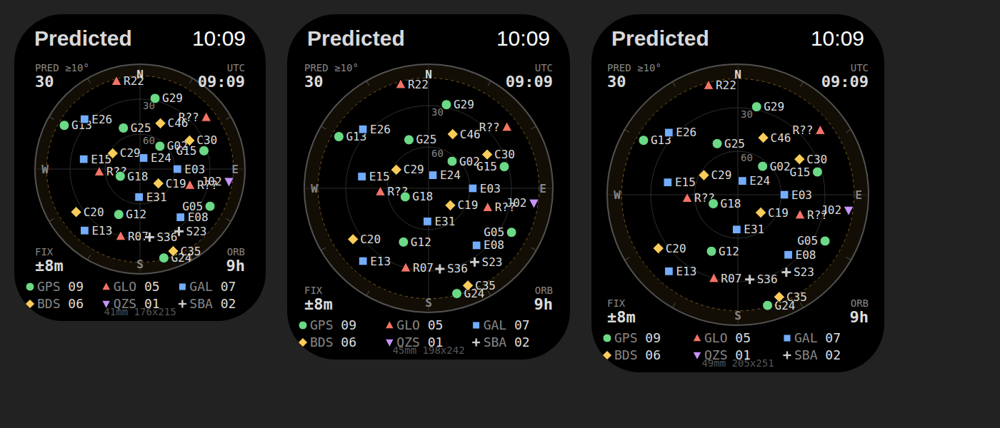

# GNSS Sky: architecture

The [capabilities research](watchOS-GNSS-capabilities.md) found that watchOS gives an app the observer's position and nothing else about GNSS. So the app is built as a prediction instrument with two inputs, position and orbital elements, and one output, an honest sky plot.



*The image above is a layout mock rendered from the same geometry as `SkyPlotView` (projection, ring radii, marker shapes, label rules) using the preview data, at the 41, 45 and 49 mm point sizes. It is not a simulator screenshot. The plot takes 70 %, 75 % and 77 % of the area below the status bar.*

## Layers

```
GNSSSky (watchOS app, SwiftUI + Core Location)        GNSSCore (Swift package, Foundation only)
───────────────────────────────────────────────        ────────────────────────────────────────
LocationService ── ObserverFix ─┐                      TwoLineElementSet   parse TLE / 3LE text
OrbitalDataService ─ catalog ───┤                      SGP4                Vallado SGP4/SDP4 port
                                ▼                      Geodesy             TEME→ECEF→az/el, WGS-84
                      SkyPlotViewModel ──────────────▶ SatelliteEngine     catalog + observer + time → SkyPosition
                                │                      VisibilityEngine    mask, sort, counts → SkySnapshot
                                ▼                      SkyPlotProjection   az/el → unit disc, tap hit-test
            SkyPlotView / SatelliteDetailView          Constellation       system + PRN from object name
                                                       OrbitalCatalog      timestamped element sets, freshness
                                                       Ephemeris           EphemerisSource protocol, CelesTrak, store
```

`GNSSCore` imports only Foundation. It builds and tests on macOS and Linux, so every number on the screen can be checked without a watch.

| Brief's component | Implementation |
| --- | --- |
| LocationService | `GNSSSky/LocationService.swift` |
| EphemerisService | `GNSSSky/OrbitalDataService.swift`, backed by `EphemerisSource` + `EphemerisStore` in `GNSSCore/Ephemeris.swift` |
| SatelliteEngine | `GNSSCore/SatelliteEngine.swift` (with `SGP4.swift`, `Geodesy.swift`) |
| VisibilityEngine | `GNSSCore/VisibilityEngine.swift` |
| SkyPlotViewModel | `GNSSSky/SkyPlotViewModel.swift` |
| SkyPlotView | `GNSSSky/SkyPlotView.swift`, `SatelliteDetailView.swift`, `Theme.swift` |

## Calculation chain

1. **Elements.** CelesTrak GP element sets, parsed with the same column checks as the reference implementation.
2. **Propagation.** A line-by-line port of Vallado's revised SGP4 (AIAA 2006-6753), using WGS-72 constants and "improved" mode. Every GNSS orbit has a period over 225 minutes, so all of them take the deep-space branch. That includes the 12-hour resonance (GPS, GLONASS, Galileo, BeiDou MEO) and the 24-hour synchronous terms (BeiDou GEO/IGSO, QZSS, SBAS). Propagation is pure: no state is cached between calls.
3. **Frames.** TEME is rotated to Earth-fixed by GMST (IAU-82, the frame SGP4 is defined in). Polar motion is ignored (< 0.0001° at GNSS range), and UT1 is taken as UTC (< 0.9 s).
4. **Look angles.** The line of sight is projected onto local east-north-up at the observer's WGS-84 geodetic position. Elevation is measured from the ellipsoid normal.
5. **Visibility.** Satellites at or above the mask (default 10°) are kept, sorted highest first and counted per constellation.
6. **Projection.** Azimuthal equidistant: radius ∝ zenith angle, north up, east right. This is the GNSS receiver convention, a map of the sky seen from above.

### Verification

- `SGP4VerificationTests` runs all 33 cases of Vallado's official verification set (`SGP4-VER.TLE` → `tcppver.out`), including the deep-space and resonance cases. All 600+ points match to 1 cm in position and 10 µm/s in velocity, and the seven intentional failure cases raise the reference's error codes in order. To check that the test can fail, three mutations were made: shifting one resonance phase constant by 0.001 rad, changing the lunar eccentricity constant, and moving the Lyddane threshold. They produced 636, 2967 and 84 failures respectively.
- `LookAngleTests` checks the whole chain (TLE → az/el/range) against Skyfield, an independent implementation with full IERS frame transforms. Nine cases (synthetic GPS-like and Galileo-like orbits plus a real geostationary satellite, at four observer sites) agree within 0.005°. That is about 1/20 of a pixel, and the residual is Skyfield's UT1 − UTC.
- Unit tests cover TLE parsing (implied decimals, Alpha-5, malformed lines), constellation and PRN identification, mask and counts, projection orientation (N top, E right, S bottom, W left, zenith centre, even ring spacing), tap selection, the cache round trip and the freshness/refresh policy.

Run them with `cd GNSSCore && swift test`.

## Orbital data

| Option | Coverage | Format effort | Accuracy for a sky plot | Chosen |
| --- | --- | --- | --- | --- |
| CelesTrak GP element sets (TLE) | All six systems in two requests | One format, one propagator | ~1 km at epoch, tens of km after weeks: ≪ 1° | **Yes** |
| RINEX broadcast navigation | All systems | Different message types per system, Keplerian + corrections | Metres | Later, for predicted DOP |
| YUMA/SEM, Galileo and BeiDou almanacs | Per system | Several formats | ~km | No |

- **Source:** `CelesTrakSource` downloads `gp.php?GROUP=gnss&FORMAT=tle` and `GROUP=sbas`. SBAS satellites are communication satellites that carry a navigation payload; the group they come from is what classifies them.
- **Abstraction:** `EphemerisSource` is a one-method protocol (`fetchCatalog() async throws -> OrbitalCatalog`). An iPhone companion relay, a bundled offline package or an almanac parser can replace CelesTrak without touching the engines.
- **Cache:** `EphemerisStore` writes the whole catalog, with `retrievedAt`, as one JSON file in Application Support. The file survives relaunch, and the app uses it offline indefinitely.
- **Refresh:** at most once a day while the app is active, retrying no sooner than 30 minutes after a failure (`RefreshPolicy`). A failed download keeps the cached catalog in service.
- **Freshness:** shown as the **median element-set age** (`ORB` readout), not the download age. Element age is what limits accuracy. Up to 3 days reads as fresh, 3 to 14 days is shown in amber, and over 14 days is stale, still plotted but flagged.

## Power

| State | Satellite recompute | Location | Orbital data |
| --- | --- | --- | --- |
| Active (wrist raised, app frontmost) | every 15 s | one fix session every 10 min | download if > 24 h old |
| Inactive (wrist down / Always On) | every 60 s, dimmed markers | off | off |
| Background | none | off | off |
| Complication (future) | WidgetKit timeline entries every 15 min from cached catalog + last fix | none | none |

- **Satellites move slowly.** As seen from the ground, a GNSS satellite crosses the sky at under 0.01°/s, so a 15 s recompute moves a marker by a fraction of a point. Propagating the whole catalog of about 140 satellites takes a few milliseconds.
- **The observer barely needs updating.** A fix session runs `CLLocationUpdate.liveUpdates()` until a fix reaches ±50 m or 45 s pass, then the location session ends. The receiver is not left running. If there is no fix at all (indoors, say), the next try comes after 60 s.
- **Scene phase drives everything.** `.task(id: activity)` cancels the active loops the moment the wrist drops, and that cancellation reaches the location session too.

## Interface

- The plot fills the width, about 70 to 77 % of the usable screen. The four corners the circle leaves free hold readouts: `PRED ≥10°` count, `UTC`, `FIX` horizontal accuracy and `ORB` element age. Constellation counts sit beneath the plot, each keyed by its marker.
- **Markers are shape-first.** Each system has its own shape: GPS ●, GLONASS ▲, Galileo ■, BeiDou ◆, QZSS ▼, SBAS ✚. Colour is a second cue, so the plot reads without colour vision.
- **Grid.** Horizon (solid), 30° and 60° rings (hairline), cardinal spokes, 30° azimuth ticks and N/E/S/W. The band below the mask is shaded and edged with a dashed amber ring, so "excluded" reads differently from "empty".
- **Empty states say why:** `NO ORBIT DATA`, `LOADING ORBITS`, `ACQUIRING FIX`, `NO FIX`, `LOCATION OFF`. An empty sky is never presented as data.
- **Tap** a marker (14 pt hit radius) to open its detail: system, ID, azimuth, elevation, range, element age, compute time, NORAD number and object name, under the line `PREDICTED · NOT RECEIVER DATA`.
- **Provenance.** Every `SkySnapshot` carries `Provenance.predicted`; the title reads "Predicted". `receiverTracked` exists so that receiver data, if it ever becomes available (for example from an external Bluetooth receiver), cannot be confused with prediction.

## Prepared for, not built

| Feature | Hook |
| --- | --- |
| Elevation-mask adjustment (Digital Crown) | `SkyPlotViewModel.elevationMaskDegrees` already feeds the engine and the mask ring |
| Constellation filtering | `SkySnapshot.visible` / `counts` are per-system |
| Satellite pass timeline, predicted count graph | `SatelliteEngine.positions(of:from:at:)` is a pure function of time |
| Predicted DOP | Look angles of visible satellites are in each snapshot |
| Complications | `GNSSCore` + `EphemerisStore` are usable from a widget extension |
| iPhone companion, offline packages | New `EphemerisSource` conformances |
| External Bluetooth receiver | `Provenance.receiverTracked` |
| Location accuracy history | `ObserverFix` carries accuracy and timestamp |

## Known limitations

- **GLONASS slot numbers** are not in CelesTrak names, so those satellites show as `R??` (see capabilities §4).
- **First launch needs a network connection** to download orbital data. No seed catalog ships, because a stale bundled catalog would be wrong in a way the user cannot see.
- **The Xcode project was written by hand** (Xcode 16 format, synchronized folder, local package). The watch app layer has not been compiled or run in a simulator; see the README.
