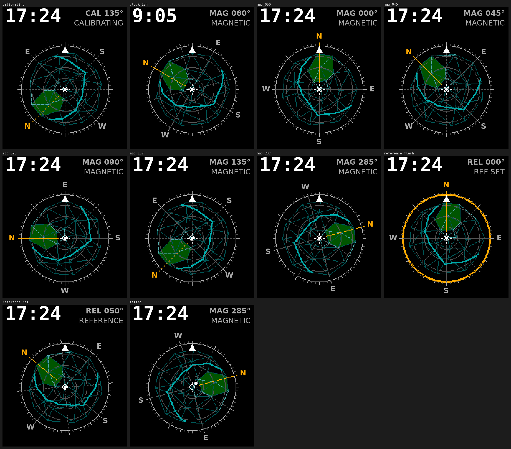

# Cardinal Grid

A Pebble Time 2 (Emery, 200 x 228, 64 colour) watch face for Globe & Atlas / GRIDCORE.
It is a small cartographic orientation instrument: range rings, radial grid lines, N/E/S/W,
a fixed heading pointer and a level bubble over a sparse synthetic TIN with a contoured
coastline. Turn your wrist and the geographic frame stays put while the watch turns
beneath it. The time is in the upper left; the upper right says exactly what the compass knows.



*Frames rendered on a computer by the firmware's own drawing code against a mock SDK. Text is
overlaid with a stand-in font, so glyph shapes and vertical text placement are approximate.*

## What it shows

| Status text | Meaning |
| --- | --- |
| `MAG 285°` | Compass calibrated. The top of the watch points at magnetic bearing 285°, shown to the 5° the grid snaps to. |
| `CAL 285°` | Compass still refining its calibration; the north axis is dashed. Move your wrist in a figure eight. |
| `CAL --` | No usable heading yet. Nothing is drawn as if it were known. |
| `REL 040°` | Reference mode: rotation from the heading you set. |
| `NO MAG` | The magnetometer service is unavailable. |

Tap the watch (a wrist tap) to set the current heading as the reference. The outer ring flashes
amber and the status line says `REF SET`. A second tap within 1.5 s clears it (cyan flash,
`REF CLEARED`). The reference is a magnetic heading, so it survives the watch face relaunching.
The centre marker's inner dot is a bubble level: centred means the watch is level and the heading
is most trustworthy.

## Build, install, test

Toolchain: the Pebble SDK (`pebble-tool`) or CloudPebble. `package.json` targets `emery` only.

```sh
pebble build                     # or: CG_DEBUG=1 pebble build   (sensor overlay)
pebble install --emulator emery
pebble install --phone <ip>
```

CloudPebble: this project needs its own repository root (CloudPebble imports the first
`package.json` with a `pebble` section), so split it out of `pebble-time` before importing.

Host tests (no Pebble SDK needed, run anywhere with gcc and Python 3):

```sh
make -C test/host test            # 2110 checks, ASan + UBSan, -Wall -Wextra -Wpedantic -Werror
make -C test/host variants        # CG_DEBUG and CG_WATCHAPP builds
make -C test/host frames && python3 test/host/preview.py test/host/build/frames test/host/build/png
python3 tools/gen_terrain.py --check && python3 tools/gen_grid_dirs.py --check
```

In the emulator, drive the sensors from the emulator's controls (for example `pebble emu-compass`,
`pebble emu-accel`, `pebble emu-tap`) and use the checklist in `docs/DESIGN.md`.

## Layout

```
src/c/cardinal_grid.c     window, layers, sensor subscriptions (glue only)
src/c/orientation/        heading + tilt conditioning, reference. No drawing, no Pebble types. Reusable.
src/c/grid/               rings, ticks, radials, cardinal positions in world space
src/c/map_geometry/       synthetic TIN, sea-level contour, cached projection
src/c/rendering/          drawing, palette, redraw throttle
src/c/time/               clock text
tools/                    generators for terrain and trig tables
test/host/                mock SDK, unit tests, event simulation, preview renderer
docs/DESIGN.md            sensors, coordinate spaces, tuning, verification status
```
